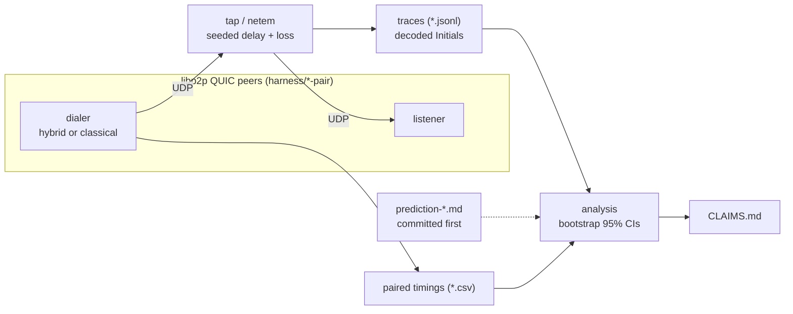

<h1 align="center">PQ-QUIC</h1>

<p align="center"><b>Hybrid post-quantum key exchange in libp2p QUIC, measured.</b><br>
Census, loss behaviour, NAT traversal and an on-path downgrade test, with every number traced to its evidence.</p>

<p align="center">
  <a href="CLAIMS.md"></a>
  
  
  <a href="#license"></a>
</p>

Every libp2p QUIC stack we tested already negotiates the hybrid TLS 1.3 group **X25519MLKEM768** by
default. This repository asks what that changes on the wire and in connection behaviour, and
answers with traces, paired benchmarks, an on-path downgrade test and pre-registered replications.

> [!IMPORTANT]
> **Every number we state lives in [`CLAIMS.md`](CLAIMS.md), and each row there points at its
> evidence.** Rows are graded (verified, strong pilot, pilot), and the retracted ones are kept. Where
> this README and CLAIMS.md disagree, CLAIMS.md is right.

<p align="center">
  
</p>
<p align="center"><sub>The core mechanism, on rust-libp2p with the first datagram dropped (C-18 to C-21, pilot grade).
Figure source: <a href="docs/make_diagrams.py"><code>docs/make_diagrams.py</code></a>, numbers taken from CLAIMS.md.</sub></p>

## Contents

- [How it works](#how-it-works)
- [Findings at a glance](#findings-at-a-glance)
- [Layout](#layout)
- [Reproducing](#reproducing)
- [Method rules](#method-rules)
- [A note on `*.keys`](#a-note-on-keys)
- [License](#license)

## How it works

The protocol is not modified. Each stack's TLS library chooses the group; the harness only watches
and perturbs the connection, and always compares against a classical baseline built from the same binary.



1. **Census.** A UDP tap captures the client's Initial packets and decrypts them with the RFC 9001
   Initial keys (`harness/tap/decode_initial.py`), so the offered and selected groups are read off the wire.
2. **Paired benchmark.** Hybrid and classical dials alternate in a seeded order, one fresh process per
   dial, through the same delay and loss (userspace tap on Windows, kernel netem on Linux).
3. **Adversary.** `harness/tap/downgrade_proxy.py` rewrites the ClientHello in flight (strip the hybrid
   group, or force a HelloRetryRequest) to see whether a classical session can be forced.
4. **NAT traversal.** A five-namespace Linux topology runs DCUtR hole punching through a relay, with controlled timing skew between the peers.

The classical baseline is `GODEBUG=tlsmlkem=0` (Go) or `PQQUIC_CLASSICAL=1` (Rust, vendored patch).

## Findings at a glance

Details and confidence intervals are in CLAIMS.md.

| | result | rows |
|---|---|---|
| **Census** | go-libp2p v0.51.0, rust-libp2p 0.57.1, js-libp2p + @chainsafe/libp2p-quic, nim-libp2p and Chrome WebTransport all select X25519MLKEM768 by default. py-libp2p on aioquic 1.7.0 is classical-only, and becomes hybrid with aioquic PR #634 alone. The hybrid ClientHello (≈1.5 KB) always spans two Initial datagrams | C-01, C-02, C-04, C-10..C-12, C-14, C-15, C-24 |
| **No loss, no cost** | Hybrid and classical handshakes take the same time at RTTs of 50, 150 and 300 ms and on a LAN | C-17, C-34 |
| **Loss: the timers decide** | rust-libp2p (quinn) connects *faster* with the hybrid hello: the second datagram earns an early ACK, so it recovers by time-threshold loss detection instead of quinn's 999 ms first probe timeout. go-libp2p (quic-go, 200 ms first PTO) sees no gain, and is slower at 10% loss. Swapping the timers swaps the outcome. A Linux kernel-netem replication registered before the run passed | C-18, C-21..C-23, C-25, C-26, C-29, C-31 |
| **Downgrade** | An on-path proxy that strips or forces away the hybrid group never yields a classical session | C-33 |
| **Hole punching** | go-libp2p DCUtR across two Linux NATs: hybrid and classical succeed equally often (100/100 at every timing skew from 0 to 1,000 ms) and the hybrid punch is 1–2 ms slower. The two-datagram hello neither helps nor hurts | C-35, C-36 |

## Layout

| path | what |
|---|---|
| `CLAIMS.md` | every claim, its grade and its evidence |
| `notes/` | method notes, and predictions committed before each run (`prediction-*.md`) with their outcomes |
| `harness/go-pair`, `rust-pair`, `js-pair`, `nim-pair` | minimal libp2p QUIC peers per stack (listen / dial / both) |
| `harness/tap/` | UDP tap with seeded loss and delay (`quic_tap.py`), Initial decoder (`decode_initial.py`), Handshake-space decryption, downgrade proxy (with tests) |
| `harness/bench_handshake.py` | paired, interleaved hybrid-vs-classical benchmark; one fresh process per dial |
| `harness/analyse_loss.py` | means, tails and bootstrap CIs for loss cells |
| `harness/linux/` | kernel-netem replication (`run_wsl.sh`, `run_netem.sh`, `run_profiles.sh`, Dockerfile) and the DCUtR hole-punch topology (`run_holepunch.sh`) |
| `data/` | traces (`*.jsonl`) and benchmark CSVs referenced from CLAIMS.md |

## Reproducing

Requirements: Go 1.26+, Rust 1.95+, Python 3.11+ (standard library, plus `cryptography` for the
decoder), Node 22 for the js peer. Linux runs need root for `tc`.

```bash
# one traced connection and its decoded ClientHello / ServerHello
cd harness && (cd go-pair && go build -o gopair .) && cargo build --release --manifest-path rust-pair/Cargo.toml
./run_pair.sh go-go "go-pair/gopair -mode listen -listen-port __LP__ -seconds 15" \
                    "go-pair/gopair -mode dial -dial-port __TP__ -peer __PEER__"
python tap/decode_initial.py --self-test          # RFC 9001 Appendix A key derivation check

# paired benchmark through the tap: 25 ms one way, 2 % loss each direction, 200 pairs
python bench_handshake.py --stack rust --pairs 200 --delay-ms 25 --loss 0.02 --seed 23 --out ../data/bench/x/rust-loss0.02.csv
python analyse_loss.py --metric elapsed_ms ../data/bench/x/*.csv

# Linux kernel netem (root), GSO off in both stacks (see the GSO note in CLAIMS.md method notes)
PQQUIC_RS_BIN=... PQQUIC_GO_BIN=... PQQUIC_DISABLE_GSO=1 QUIC_GO_DISABLE_GSO=true SEED=41 bash linux/run_wsl.sh
PQQUIC_RS_BIN=... PQQUIC_GO_BIN=... PQQUIC_DISABLE_GSO=1 QUIC_GO_DISABLE_GSO=true bash linux/run_profiles.sh

# live downgrade attempt
./run_downgrade.sh downgrade-go-strip strip "<listen cmd>" "<dial cmd>"
```

The classical baselines are `GODEBUG=tlsmlkem=0` (Go) and `PQQUIC_CLASSICAL=1` (Rust, vendored patch).
The patched timers (`PQQUIC_INITIAL_RTT_MS`, `PQQUIC_INITIAL_PACKET_SIZE`) are only for the causal
runs C-26, C-27 and C-29; see `NOTICE`.

## Method rules

- Predictions are committed before each run, and outcomes are added afterwards, including failures
  (C-30 did not pass; C-34's LAN prediction failed).
- Hybrid and classical dials are paired and interleaved in a seeded order, one fresh process per
  dial, so machine drift is shared by both variants.
- Never run two benchmarks at once, and keep the machine otherwise idle. One run is recorded as
  invalid because agent CPU load and host sleep overlapped it.

## A note on `*.keys`

Some runs under `data/bench/` include `*.keys` files: TLS key logs (NSS format) written with
`--keylog` for throwaway loopback test connections, so that Handshake packets in the traces can be
decrypted (C-28). They hold no long-term keys and protect no real traffic. Never use `--keylog`
outside a test harness.

## License

Dual-licensed under MIT ([`LICENSE-MIT`](LICENSE-MIT)) or Apache-2.0 ([`LICENSE-APACHE`](LICENSE-APACHE)),
at your option. Vendored third-party code keeps its own license; see [`NOTICE`](NOTICE).
